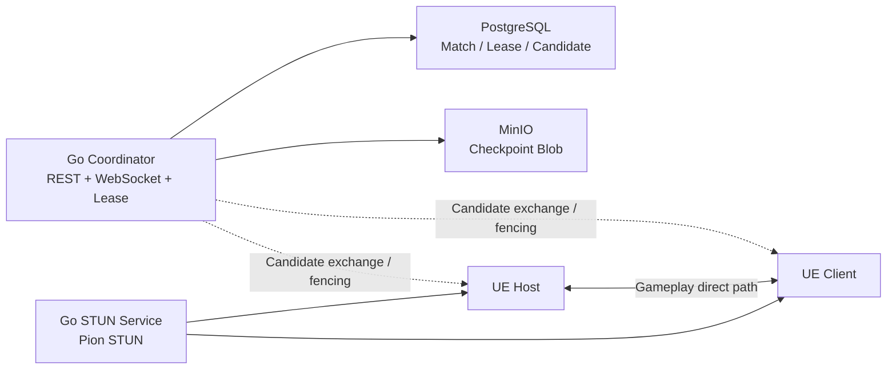

# LetsDeepRock 自建 Go Coordinator + STUN/ICE/Relay 完整实施计划

## Summary

为 LetsDeepRock 增加一个独立 Go 中心服务，负责身份、Match、Host Lease、AuthorityEpoch、Checkpoint 元数据、候选地址交换和 Host Migration 协调。

Gameplay Authority 仍然是当前 Host Listen Server；Coordinator 不运行 Unreal Gameplay World。

第一阶段复用现有 `IpNetDriver`，实现：

- 公网 Host 的 DDNS 直连；
- Coordinator 注册与 Lease；
- STUN 公网候选地址发现；
- Endpoint candidate 交换；
- Central Checkpoint 上传与恢复选择；
- Host Migration 后的新 endpoint 发布。

Relay 和严格 NAT 兼容需要第二阶段增加自定义 UE transport；不能声称仅通过 STUN 就能覆盖所有网络。

## Locked decisions

- 服务语言：Go。
- Go 服务目录：`Services/Coordinator/`。
- 部署方式：Linux 原生二进制 + systemd。
- 数据库：PostgreSQL。
- Checkpoint Blob：MinIO，使用 S3-compatible API。
- TLS：Go 直接加载证书文件，不依赖反向代理。
- 身份：设备 Ed25519 密钥 + Match Join Code。
- 控制协议：版本化 HTTPS REST + WebSocket 事件通道。
- STUN：Pion STUN 实现。
- Relay：第一阶段预留协议和 API，第二阶段实现自建 UDP Relay。
- UE 第一阶段：继续复用现有 `IpNetDriver` 和 `ClientTravel`。
- UE Relay 阶段：引入自定义 transport/NetDriver，不修改 Gameplay RPC 和 Replication 语义。
- 当前 5 秒完整 Snapshot 保留，继续作为初始 RPO。
- Central/Local backend 在 Match 内锁定，不允许中心断线后静默切换造成 split-brain。

## Architecture



Coordinator 负责控制面：

```text
Device authentication
-> Match join
-> Role Assignment
-> AuthorityEpoch / Host Lease
-> Endpoint candidate exchange
-> Checkpoint commit metadata
-> Host migration claim
-> New Host endpoint publication
```

Gameplay 数据面仍然是：

```text
Client intent
-> Host Server RPC
-> Host mutation
-> Replication / OnRep
```

## Repository layout

新增独立服务：

```text
Services/
  Coordinator/
    cmd/coordinator/main.go
    internal/httpapi/
    internal/auth/
    internal/match/
    internal/lease/
    internal/checkpoint/
    internal/candidate/
    internal/stun/
    internal/relay/
    internal/store/
    internal/config/
    migrations/
    go.mod
    go.sum
    README.md
    deploy/
      letsdeeprock-coordinator.service
      letsdeeprock-stun.service
      letsdeeprock-relay.service
      coordinator.env.example
```

UE 侧新增：

```text
Source/LetsDeepRock/Variant_Weapon/Online/
  WeaponCentralConnectivityTypes.h
  WeaponCentralConnectivitySubsystem.h
  WeaponCentralConnectivitySubsystem.cpp
```

现有代码的职责保持：

- `UWeaponHostMigrationSubsystem`：统一迁移状态机、Epoch fence、RecoveryReady barrier；
- `UWeaponSnapshotCoordinator`：Capture/Serialize/Validate/Restore；
- `UWeaponSessionSubsystem`：LAN Session、Direct Travel、Recovery World travel；
- `AWeaponGameMode`：Roster、Slot、Gameplay Authority；
- `UWeaponCentralConnectivitySubsystem`：Coordinator 连接、STUN candidate、endpoint 状态，不直接推进迁移状态机。

## Protocol types

UE 与 Go 共享一个显式版本号：

```text
ProtocolVersion
SchemaVersion
```

候选地址结构：

```text
EndpointCandidate:
  MatchId
  AuthorityEpoch
  PeerId
  CandidateId
  Transport
  CandidateType
  Address
  Port
  Priority
  Foundation
  ExpiresAt
  RelayAllocationId
  Signature
```

CandidateType：

```text
Host
ServerReflexive
Relayed
```

Transport：

```text
UDP
TCP
Relay
```

Connectivity state：

```text
Gathering
Checking
DirectConnected
Relayed
Failed
Expired
```

所有 candidate、Lease、checkpoint 和 migration event 必须携带：

```text
MatchId
AuthorityEpoch
RosterRevision
PeerId
```

旧 Epoch 的 candidate 永远不能覆盖新 Epoch。

## Coordinator REST API

### Device authentication

```text
POST /v1/devices/challenge
POST /v1/devices/register
POST /v1/devices/session
```

流程：

```text
Client generates Ed25519 keypair
-> Coordinator returns nonce
-> Client signs nonce
-> Coordinator returns short-lived access token
```

Join Code 只用于加入 Match，不作为长期身份。

### Match lifecycle

```text
POST /v1/matches
POST /v1/matches/{matchId}/join
POST /v1/matches/{matchId}/leave
GET  /v1/matches/{matchId}
GET  /v1/matches/{matchId}/events
```

WebSocket 事件：

```text
RoleAssignment
LeaseGranted
LeaseRenewed
HostEndpointPublished
CandidateUpdated
CheckpointCommitted
MigrationStarted
MigrationClaimed
MigrationCommitted
MigrationFailed
```

### Host Lease

```text
POST /v1/matches/{matchId}/lease/heartbeat
POST /v1/matches/{matchId}/lease/claim
POST /v1/matches/{matchId}/lease/release
```

事务约束：

- 一个 Match 只有一个 active Lease；
- `AuthorityEpoch` 单调递增；
- Lease claim 必须验证候选者身份和旧 Epoch；
- 同一 Epoch 不允许不同 Active Host；
- 已提交的 Host Claim 不能被旧 Host 覆盖；
- Lease 过期只允许符合 successor policy 的候选者 claim。

### Endpoint candidates

```text
POST /v1/matches/{matchId}/peers/{peerId}/candidates
GET  /v1/matches/{matchId}/peers/{peerId}/candidates
POST /v1/matches/{matchId}/connectivity/check-result
POST /v1/matches/{matchId}/connectivity/nominate
```

Coordinator 只交换 candidate 和记录 connectivity result，不把普通控制连接当作 Gameplay 通道。

## STUN service

实现标准 Binding Request/Response：

```text
UDP :3478
```

端口可通过配置改变，家庭网络外部端口可以映射到其他高位端口。

STUN 响应至少返回：

```text
XOR-MAPPED-ADDRESS
SOFTWARE
MESSAGE-INTEGRITY
FINGERPRINT
```

服务必须限制：

- 单 IP 请求频率；
- 单设备并发请求；
- malformed packet；
- UDP packet size；
- 日志中的敏感地址暴露。

STUN 只提供 server-reflexive candidate，不负责保证直连。

## Checkpoint storage

Checkpoint payload 不直接长期存 PostgreSQL。

流程：

```text
Host -> Coordinator: begin upload
Coordinator -> Host: MinIO presigned PUT URL
Host -> MinIO: upload serialized SaveGame
Host -> Coordinator: commit request with hash/metadata
Coordinator -> MinIO: stream verify size/hash
Coordinator -> PostgreSQL: atomic commit metadata
Coordinator -> all peers: CheckpointCommitted event
```

MinIO object key：

```text
matches/{matchId}/epochs/{authorityEpoch}/snapshots/{revision}-{sha256}.sav
```

PostgreSQL 保存：

```text
devices
matches
match_peers
role_assignments
leases
endpoint_candidates
checkpoints
relay_allocations
audit_events
```

Checkpoint commit 必须同时验证：

```text
MatchId
AuthorityEpoch
RosterRevision
SnapshotRevision
PayloadHash
PayloadSize
SaveFormatVersion
SnapshotSchemaVersion
```

同 Revision 不同 Hash 必须 conflict/fail closed。

## UE integration

### `UWeaponCentralConnectivitySubsystem`

职责：

- 建立 Coordinator TLS 控制连接；
- 设备 challenge/signature；
- 创建/加入 Match；
- 接收 Role Assignment 和 Lease；
- 发起 STUN candidate gathering；
- 上传 candidate；
- 接收 nominated endpoint；
- 通知 `UWeaponHostMigrationSubsystem`；
- 不直接修改 GameMode 或 Migration state。

### Backend readiness

Central backend 只有在以下条件都满足后才提交：

```text
CentralControlReady
CentralLeaseReady
FirstCheckpointCommitted
```

Gameplay path readiness 单独管理：

```text
DirectEndpointReachable
or
RelayPathReady
```

初始阶段由于复用 `IpNetDriver`，只接受：

```text
DirectEndpointReachable
```

Relay candidate 只能在自定义 transport 完成后启用。

### Existing SessionSubsystem changes

保留：

```cpp
JoinDirectAddress(...)
ReconnectToMigratedHost(...)
```

新增行为：

```text
Coordinator returns nominated direct endpoint
-> UWeaponCentralConnectivitySubsystem validates Match/Epoch
-> UWeaponSessionSubsystem::ReconnectToMigratedHost(endpoint)
```

LAN mode 和 Public Direct mode 必须显式区分：

```text
LocalP2P:
  bIsLANMatch = true
  LAN discovery enabled

CentralAssisted/PublicDirect:
  bIsLANMatch = false
  no LAN broadcast dependency
  endpoint comes from Coordinator/DDNS
```

不得让每个 Client 根据自己的网络观察自行选择 backend；Host/Coordinator 发布统一 Match decision。

## Host Migration integration

迁移流程：

```text
Host failure detected
-> Coordinator validates old Lease
-> successor claim establishes new AuthorityEpoch
-> successor downloads selected committed checkpoint
-> successor restores gated Recovery World
-> successor gathers endpoint candidates
-> Coordinator publishes new endpoint
-> Clients reconnect to new endpoint
-> RecoveryReady ACK barrier
-> gameplay resumes
```

Central committed checkpoint优先级：

```text
CentralCommitted
-> conflict/stale/unavailable
-> LocalCommonCommitted
-> Recovery Lobby
```

同一 Match 的 Central-to-Local 切换不能静默发生。

如果 Central mode 下中心不可达：

- 当前 Host 在有效 Lease 内继续运行；
- Lease 失效后不允许旧 Host继续发布权威状态；
- 若无法建立安全的新 authority term，则进入 Recovery Lobby；
- Local Save/CommonCommitted 只能在已明确 fenced 的新 term 中使用。

## Relay phase

由于第一阶段复用 `IpNetDriver`，Relay 不在第一阶段承诺可用。

第二阶段新增：

```text
WeaponRelayNetDriver
WeaponRelaySocket
Relay allocation/token
Virtual peer endpoint
```

Relay 必须支持：

- 每个 Match/Peer 独立 allocation；
- 短期 token；
- 双向 datagram forwarding；
- idle timeout；
- bandwidth limit；
- packet size limit；
- MatchId/Epoch fencing；
- allocation revoke；
- relay path health check。

Gameplay 层不应知道自己使用的是 direct 还是 relay。

## Go implementation

推荐依赖：

```text
github.com/pion/stun
github.com/google/uuid
github.com/jackc/pgx/v5
github.com/minio/minio-go/v7
github.com/golang-jwt/jwt/v5
```

Go 服务使用：

```text
net/http
gorilla/websocket 或标准 WebSocket 实现
log/slog
context
database/sql / pgx
```

所有外部依赖版本必须在实现前固定并通过 Go module/CI 验证。

## Deployment

Coordinator 使用 systemd 原生二进制：

```text
/usr/local/bin/letsdeeprock-coordinator
/etc/letsdeeprock/coordinator.env
/var/lib/letsdeeprock/
```

服务单元：

```text
letsdeeprock-coordinator.service
letsdeeprock-stun.service
letsdeeprock-relay.service
```

TLS：

```text
TLS_CERT_FILE
TLS_KEY_FILE
```

用户自行提供证书并负责更新；Go 进程支持 reload/restart。

网络端口：

```text
TCP: Coordinator HTTPS/WSS
UDP: STUN
UDP: Relay allocation range
```

PostgreSQL 和 MinIO 只监听 localhost 或内网地址，不直接暴露公网。

## Test plan

### Go unit tests

- Ed25519 challenge/signature；
- Join Code 过期与重放；
- Lease 单调 Epoch；
- 同 Epoch 冲突 Host claim；
- candidate stale/conflict；
- candidate expiration；
- checkpoint hash/size/schema validation；
- idempotent checkpoint commit；
- relay allocation expiry；
- authorization by MatchId/Epoch/PeerId。

### Go integration tests

- PostgreSQL transaction race；
- MinIO upload/commit；
- WebSocket reconnect；
- Coordinator restart；
- Lease expiry；
- duplicate requests；
- old Epoch event rejection。

### UE Automation

- Central control readiness；
- Central checkpoint commit；
- Local fallback before central commit；
- locked backend refuses live downgrade；
- nominated endpoint accepts matching Match/Epoch；
- stale endpoint rejected；
- migration reconnect waits for endpoint readiness；
- RecoveryReady remains gated until reconnect and ACK。

### Physical network acceptance

至少使用：

```text
Home A: Host
Home B: Client
Home C: Backup candidate
```

测试矩阵：

- public IPv4 direct；
- ordinary NAT；
- CGNAT；
- symmetric NAT；
- direct success；
- STUN candidate success；
- direct failure + Relay success；
- Host migration after endpoint change；
- DDNS IP change；
- Coordinator restart；
- STUN unavailable；
- Relay unavailable。

只有完成真实跨网络测试后，才能声称“互联网 Host Migration 可用”。

## Git workflow

从当前 `codex/migration-central-client` 创建：

```text
codex/central-coordinator-go
```

建议原子提交：

1. `docs: define go coordinator stun ice relay contract`
2. `feat: scaffold go coordinator service`
3. `feat: add device and match authentication`
4. `feat: add lease and epoch transactions`
5. `feat: add checkpoint metadata and minio storage`
6. `feat: add stun candidate gathering`
7. `feat: add ue central connectivity client`
8. `test: cover coordinator protocol and lease fencing`
9. `test: cover physical public endpoint flow`

每个垂直切片单独编译/测试并推送，创建 stacked PR。

## Teaching sequence

Coding Tutor 后续按三课展开：

1. `Go Coordinator 的 HTTP/WebSocket/Lease 服务生命周期`
2. `STUN、ICE candidate 与 NAT 映射`
3. `UE IpNetDriver、Relay transport 与 Host Migration endpoint fencing`

每课都使用当前 LetsDeepRock 的：

- `UWeaponHostMigrationSubsystem`
- `UWeaponSessionSubsystem`
- `FWeaponCentralHostLease`
- `FWeaponMigrationBackendState`
- `RecoveryReady`

## Explicit assumptions

- 当前 Match 仍由 Host 承载 Gameplay Authority。
- 第一阶段不删除 5 秒完整 Snapshot。
- 第一阶段的成功标准是公网 direct endpoint + Coordinator checkpoint。
- Relay 需要第二阶段自定义 UE transport 才能真正纳入 Gameplay。
- PostgreSQL、MinIO 与 Go Coordinator 在同一台 Linux 家宽服务器上运行。
- 新计划文件位于 `Docs/`，但当前 `.gitignore` 的 `docs/` 规则会忽略它；如果需要提交 Git，必须显式调整规则或使用 `git add -f`。
